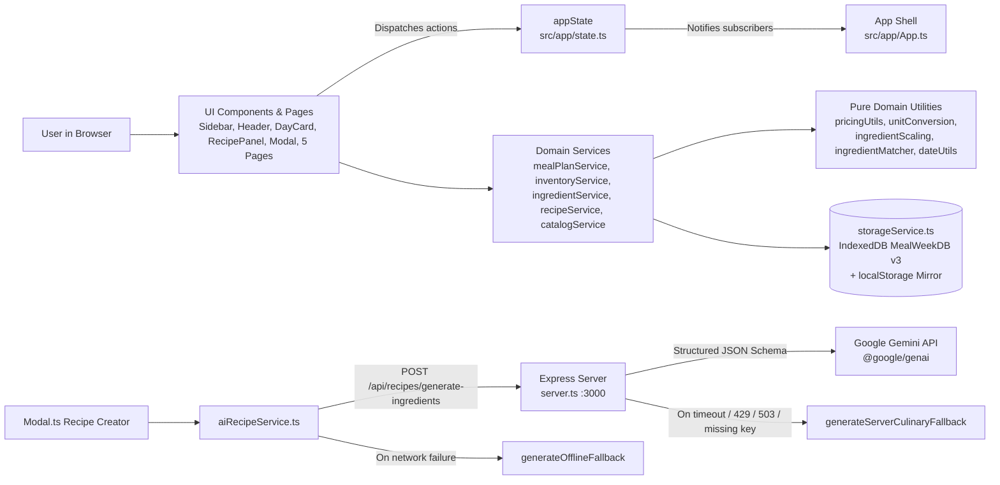
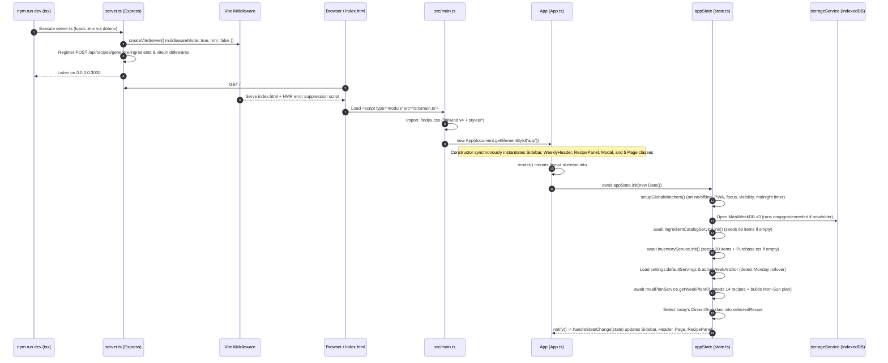
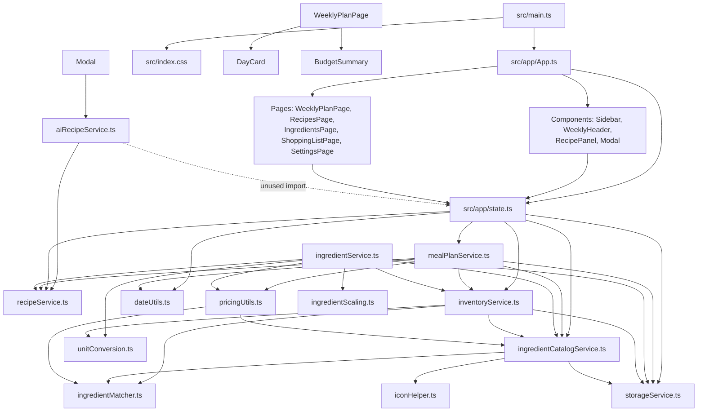
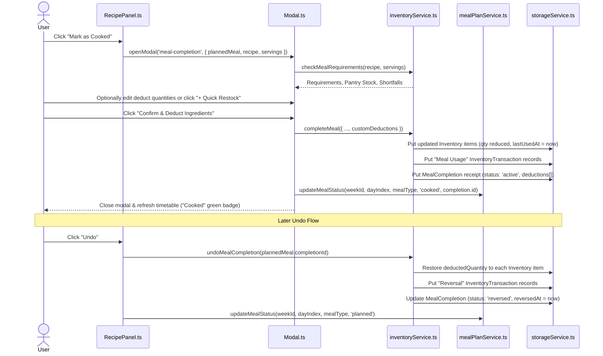
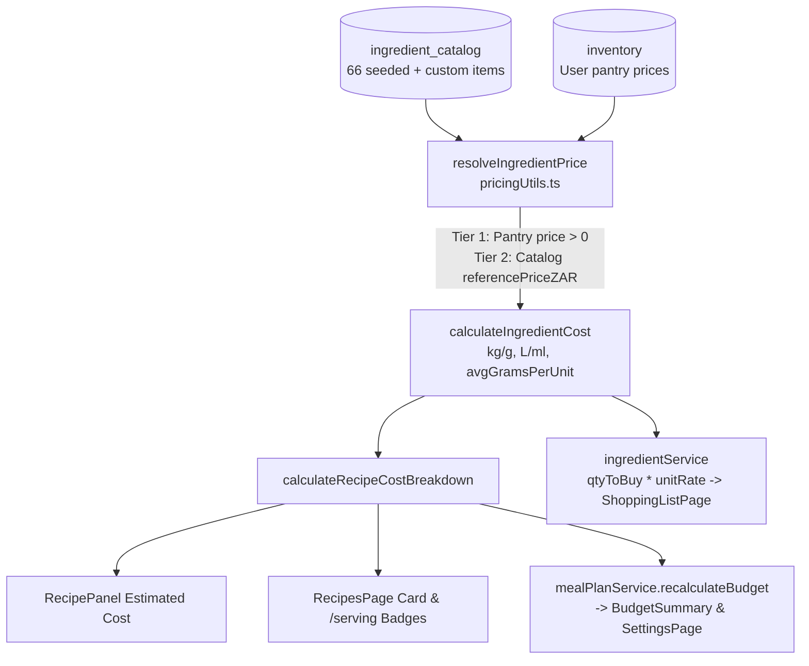
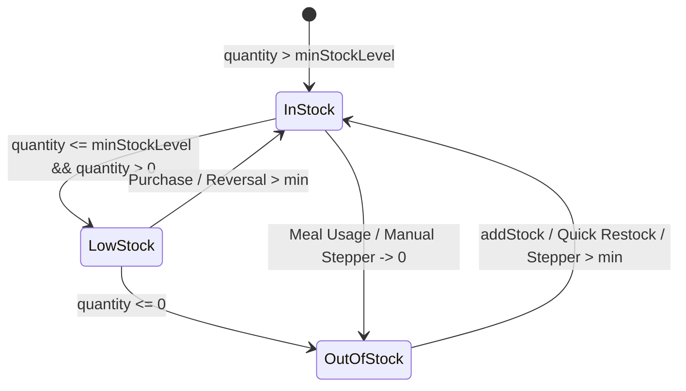
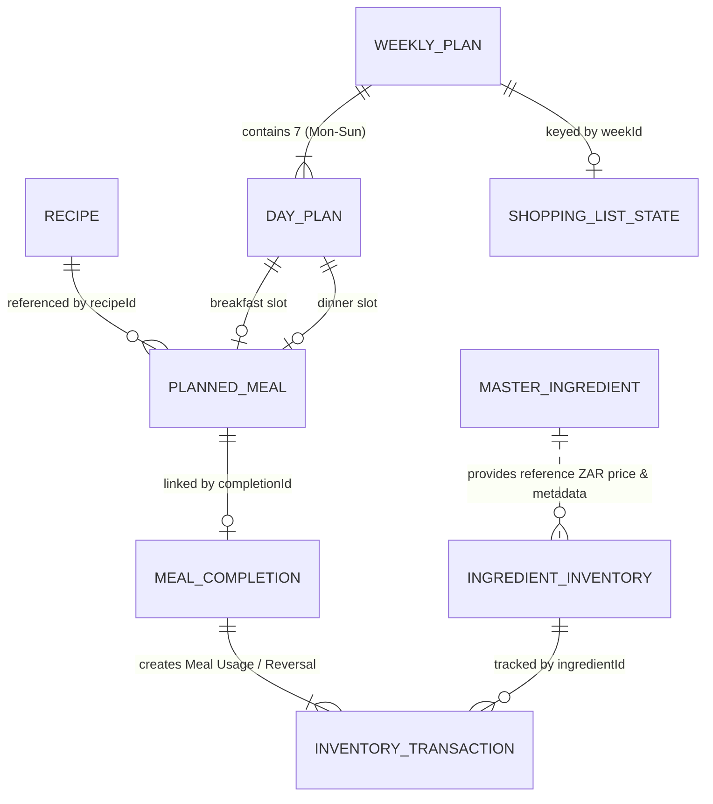

# MEAL PLANNING WEB APPLICATION
## Complete Technical Documentation, Codebase Analysis & Architecture Guide

**Application Name:** MealWeek (`metadata.json` / `index.html`; `"name": "react-example"` in `package.json`)  
**Repository Snapshot / Scope:** Reverse-engineering analysis of all **74 discovered files** (excluding `node_modules/`, `.git/`, and `dist/`).  
**Analysis Methodology:** Direct static source inspection of every configuration, server, styling, model, utility, service, component, page, asset, and documentation file.

### Inspection Completion Checklist
- [x] **Phase One — Complete Codebase Inventory** (74 / 74 files cataloged & classified)
- [x] **Phase Two — Technology Stack Analysis** (all runtime & dev dependencies verified against actual imports)
- [x] **Phase Three — Complete Application Architecture** (Frontend, Backend, Persistence, Communication)
- [x] **Phase Four — Complete File-by-File Documentation** (All 74 files documented with A–M structure)
- [x] **Phase Five — Application Entry Points & Initialization** (`server.ts`, `index.html`, `src/main.ts`, `App.ts`, `state.ts`)
- [x] **Phase Six — File Dependency & Relationship Map**
- [x] **Phase Seven — API & Workflow Documentation** (`POST /api/recipes/generate-ingredients` + E2E workflows)
- [x] **Phase Eight — Data Flow Diagrams**
- [x] **Phase Nine — Database Schema & Persistence Model** (`MealWeekDB` v3 IndexedDB + `localStorage`)
- [x] **Phase Ten — Technical Concepts Glossary**
- [x] **Phase Eleven — Execution & Build Guide**
- [x] **Phase Twelve — Architectural Assessment & Final Summary**

---

## Table of Contents

1. [Cover Page & Inspection Checklist](#meal-planning-web-application)
2. [Table of Contents](#table-of-contents)
3. [Project Overview](#3-project-overview)
4. [Technology Stack](#4-technology-stack)
5. [Complete Directory Structure & File Inventory](#5-complete-directory-structure--file-inventory)
6. [Application Architecture](#6-application-architecture)
7. [Application Initialization and Execution](#7-application-initialization-and-execution)
8. [Frontend Architecture](#8-frontend-architecture)
9. [Backend Architecture](#9-backend-architecture)
10. [Database Architecture](#10-database-architecture)
11. [Complete File-by-File Documentation](#11-complete-file-by-file-documentation)
12. [File Dependency and Relationship Mapping](#12-file-dependency-and-relationship-mapping)
13. [API Documentation](#13-api-documentation)
14. [End-to-End Feature Workflows](#14-end-to-end-feature-workflows)
15. [Data Flow Diagrams](#15-data-flow-diagrams)
16. [Database Diagrams](#16-database-diagrams)
17. [Technical Concepts and Programming Glossary](#17-technical-concepts-and-programming-glossary)
18. [Application Execution Guide](#18-application-execution-guide)
19. [Architectural Assessment](#19-architectural-assessment)
20. [Final Technical Summary](#20-final-technical-summary)

---

## 3. Project Overview

**MealWeek** is an offline-capable Progressive Web Application (PWA) for weekly meal planning, recipe management, pantry inventory tracking, smart grocery shopping list generation, and South African Rand (`ZAR` / `R`) food cost estimation.

Contrary to what `package.json` metadata (`"name": "react-example"`, `react`, `react-dom`, `lucide-react`, `motion`) suggests, inspection of the actual source reveals that **MealWeek does not use React or any client-side UI framework**. Instead, it is built with **modular Vanilla TypeScript**, **Tailwind CSS v4**, custom CSS glassmorphism, custom inline SVG icons, a browser-local **IndexedDB + `localStorage` dual-write persistence engine**, and a lightweight **Node.js / Express backend** whose sole API responsibility is AI-assisted recipe ingredient generation via the **Google Gemini API (`@google/genai`)** with deterministic server and client fallbacks.

### Core System Capabilities
1. **Calendar-Locked Weekly Planning (`Monday – Sunday`)**: Computes canonical `week-YYYY-MM-DD` Monday-anchored keys, renders 7 daily cards (Breakfast + Dinner slots), persists per-week schedules, highlights `Today`, and automatically rolls over on Monday midnight/focus/visibility changes.
2. **Dynamic Serving Scaling & Costing**: Scales recipe ingredients proportionally (`scaledQty = baseQty * (targetServings / baseServings)`) and calculates single-figure recipe totals and weekly budget totals using a **two-tier ZAR price resolver** (Household Pantry price override -> 66-item Master Ingredient Price Catalog with `avgGramsPerUnit` / `avgMlPerUnit` equivalence).
3. **Pantry Inventory & Cooking Audit Trail**: Tracks household stock quantities, dynamically computes stock status (`In Stock`, `Low Stock`, `Out of Stock`), validates shortages in a "Mark as Cooked" modal, executes stock deductions into `meal_completions`, supports full `Undo` reversal, and records an immutable `inventory_transactions` log (`Purchase`, `Meal Usage`, `Manual Adjustment`, `Reversal`, `Waste`).
4. **Smart Shopping List**: Aggregates scaled weekly ingredient requirements across all planned meals, subtracts matching pantry stock (`toBuy = max(0, required - inStock)`), estimates missing grocery spend, tracks checkboxes, and restocks purchased items back into pantry inventory.
5. **AI Recipe Ingredient Auto-Fill**: Sends recipe titles to `POST /api/recipes/generate-ingredients`, using structured JSON schemas with `@google/genai` (fallback chain `gemini-3.8-flash` -> `gemini-flash-latest` -> `gemini-3.1-flash-lite`), a server-side culinary fallback, and a client-side offline fallback.

---

## 4. Technology Stack

### Verified Runtime & Build Dependencies (`package.json`)

| Dependency | Version | Category | Verification | Purpose, Usage & Dependent Files |
| :--- | :--- | :--- | :--- | :--- |
| **TypeScript** (`typescript`) | `^7.0.2` | Language / Dev Tool | Active | Strongly typed superset of JavaScript compiling/type-checking via `npm run lint` (`tsc --noEmit`) and stripped at runtime by `tsx`/Vite. Used across all `.ts` files in `server.ts` and `src/`. |
| **Express** (`express`, `@types/express`) | `^4.21.2` | Backend Framework | Active | HTTP server framework handling JSON parsing (`express.json()`), `POST /api/recipes/generate-ingredients`, Vite dev middleware mounting, and production static serving (`dist/`). Used in `server.ts`. |
| **@google/genai** | `^2.4.0` | AI SDK | Active | Official Google Gemini TypeScript SDK (`GoogleGenAI`, `ThinkingLevel`, `Type`) used exclusively server-side in `server.ts` for structured JSON recipe generation. |
| **dotenv** | `^17.2.3` | Env Config | Active | Loads `.env` variables (`GEMINI_API_KEY`, `PORT`) into `process.env` at startup in `server.ts`. |
| **tsx** | `^4.21.0` | TS Runner | Active | Executes `server.ts` directly in TypeScript during development (`npm run dev` -> `tsx server.ts`). |
| **Vite** (`vite`) | `^8.3.0` | Build Tool / Dev Middleware | Active | Bundles frontend assets (`vite build`), generates ESM dev modules via `createViteServer({ middlewareMode: true })` in `server.ts`, and reads `vite.config.ts`. |
| **@tailwindcss/vite** & **tailwindcss** | `^4.3.3` | CSS Framework | Active | Tailwind CSS v4 Vite plugin loaded in `vite.config.ts` and imported via `@import "tailwindcss";` in `src/index.css` to compile utility classes across all components and pages. |
| **vite-plugin-pwa** | `^2.0.0` | PWA / Service Worker | Active | Generates `manifest.webmanifest`, precache manifests (`workbox`), and dev service worker artifacts (`dev-dist/sw.js`, `dev-dist/workbox-afac4cd2.js`). Configured in `vite.config.ts`; client types in `tsconfig.json`. |
| **@types/node** | `^22.14.0` | Type Defs | Active | Node.js type definitions (`process`, `path`, `fs`, `zlib`) supporting `server.ts` and `vite.config.ts`. |
| **autoprefixer** | `^10.4.21` | PostCSS Tool | Indirect/Dev | Present in `devDependencies`; Tailwind v4 `@tailwindcss/vite` handles vendor prefixing natively via Lightning CSS. |
| **esbuild** | `^0.25.0` | Bundler Tool | Indirect/Dev | Present in `devDependencies` (commonly paired with Vite/tsx internals). |

### Declared but Unused Dependencies in `package.json`
Inspection via static imports confirms **zero** files in `src/` or `server.ts` import these packages, and `vite.config.ts` does not register `@vitejs/plugin-react`:
- `react` (`^19.0.1`), `react-dom` (`^19.0.1`), `@types/react` (`^19.3.0`), `@types/react-dom` (`^19.3.0`), `@vitejs/plugin-react` (`^6.1.1`)
- `lucide` (`^1.66.0`), `lucide-react` (`^0.546.0`) — replaced by bespoke inline SVGs in `src/utils/iconHelper.ts`
- `motion` (`^12.23.24`) — animations use CSS `@keyframes fadeIn` and Tailwind transitions

### Browser & Node APIs (Standard Library)
- **Browser APIs**: `window.indexedDB`, `window.localStorage`, `navigator.serviceWorker`, `navigator.clipboard`, `BeforeInstallPromptEvent`, `window.matchMedia`, `fetch`, `setTimeout`, `confirm` (native dialog).
- **Node.js Built-ins**: `fs`, `zlib` (`generate-icons.js`), `path` (`server.ts`, `vite.config.ts`).

---

## 5. Complete Directory Structure & File Inventory

### Project Directory Tree (74 Files)
```text
.
├── .env.example
├── README.md
├── bun.lock
├── dev-dist/
│   ├── sw.js
│   └── workbox-afac4cd2.js
├── docs/
│   ├── HOW_THE_APP_WORKS.md
│   └── MEALWEEK_DOCUMENTATION.md
├── generate-icons.js
├── index.html
├── metadata.json
├── package.json
├── public/
│   ├── apple-touch-icon.png
│   ├── assets/
│   │   └── aistudio/
│   │       ├── Glassmorphism_Weekly_Meal_Planner__1__dfa0c63c.png
│   │       └── Screenshot__291__410e881b.png
│   ├── icon.svg
│   ├── pwa-192x192.png
│   ├── pwa-512x512.png
│   └── pwa-maskable-512x512.png
├── server.ts
├── src/
│   ├── app/
│   │   ├── App.ts
│   │   └── state.ts
│   ├── assets/
│   │   └── images/ (13 .jpg files)
│   ├── components/
│   │   ├── BudgetSummary.ts
│   │   ├── DayCard.ts
│   │   ├── Modal.ts
│   │   ├── RecipePanel.ts
│   │   ├── Sidebar.ts
│   │   └── WeeklyHeader.ts
│   ├── index.css
│   ├── main.ts
│   ├── models/ (8 .ts files)
│   ├── pages/ (5 .ts files)
│   ├── services/ (7 .ts files)
│   ├── styles/ (4 .css files)
│   └── utils/ (6 .ts files)
├── tsconfig.json
└── vite.config.ts
```

### Complete File Inventory Table (All 74 Discovered Files)

| # | Filename | Relative Path | Ext | Category | Primary Purpose | Analysed |
|:-:|:---|:---|:---|:---|:---|:---:|
| 1 | `.env.example` | `.env.example` | (env) | Configuration | Template documenting required runtime env vars (`GEMINI_API_KEY`, `APP_URL`) | Yes |
| 2 | `README.md` | `README.md` | `.md` | Documentation | Project overview, feature guide, and codebase directory summary | Yes |
| 3 | `bun.lock` | `bun.lock` | `.lock` | Configuration | Dependency lockfile generated by Bun (`lockfileVersion: 2`) | Yes |
| 4 | `generate-icons.js` | `generate-icons.js` | `.js` | Build Utility | Standalone Node script synthesizing PNG PWA icons in `public/` | Yes |
| 5 | `index.html` | `index.html` | `.html` | Frontend Entry | HTML shell, SEO/PWA meta tags, Google Fonts, `#app` mount, `/src/main.ts` | Yes |
| 6 | `metadata.json` | `metadata.json` | `.json` | Configuration | AI Studio applet metadata declaring name, description, and server Gemini capability | Yes |
| 7 | `package.json` | `package.json` | `.json` | Configuration | NPM package manifest, scripts (`dev`, `start`, `build`, `lint`), and dependencies | Yes |
| 8 | `server.ts` | `server.ts` | `.ts` | Backend / Server | Express HTTP server, `/api/recipes/generate-ingredients`, Vite dev middleware, prod SPA | Yes |
| 9 | `tsconfig.json` | `tsconfig.json` | `.json` | Configuration | TypeScript compiler configuration (`ES2022`, Vite/PWA types, path alias `@/*`) | Yes |
| 10 | `vite.config.ts` | `vite.config.ts` | `.ts` | Configuration | Vite bundler setup with Tailwind v4 plugin, VitePWA Workbox config, port 3000 | Yes |
| 11 | `sw.js` | `dev-dist/sw.js` | `.js` | Generated / PWA | Auto-generated development Service Worker loader referencing Workbox bundle | Yes |
| 12 | `workbox-afac4cd2.js` | `dev-dist/workbox-afac4cd2.js` | `.js` | Generated / PWA | Auto-generated Workbox v7.4.0 runtime bundle for dev SW testing | Yes |
| 13 | `HOW_THE_APP_WORKS.md` | `docs/HOW_THE_APP_WORKS.md` | `.md` | Documentation | End-user & architecture walkthrough document | Yes |
| 14 | `MEALWEEK_DOCUMENTATION.md` | `docs/MEALWEEK_DOCUMENTATION.md` | `.md` | Documentation | System workflows, design tokens, and IndexedDB reference doc | Yes |
| 15 | `apple-touch-icon.png` | `public/apple-touch-icon.png` | `.png` | Static Asset | 180x180 iOS home-screen PNG icon generated by `generate-icons.js` | Yes |
| 16 | `Glassmorphism_Weekly_Meal_Planner__1__dfa0c63c.png` | `public/assets/aistudio/Glassmorphism_Weekly_Meal_Planner__1__dfa0c63c.png` | `.png` | Static Asset | UI visual design reference screenshot (unreferenced in runtime code) | Yes |
| 17 | `Screenshot__291__410e881b.png` | `public/assets/aistudio/Screenshot__291__410e881b.png` | `.png` | Static Asset | UI reference screenshot (unreferenced in runtime code) | Yes |
| 18 | `icon.svg` | `public/icon.svg` | `.svg` | Static Asset | Scalable SVG brand icon (champagne squircle with chef hat) | Yes |
| 19 | `pwa-192x192.png` | `public/pwa-192x192.png` | `.png` | Static Asset | 192x192 PWA manifest app icon | Yes |
| 20 | `pwa-512x512.png` | `public/pwa-512x512.png` | `.png` | Static Asset | 512x512 PWA manifest app icon | Yes |
| 21 | `pwa-maskable-512x512.png` | `public/pwa-maskable-512x512.png` | `.png` | Static Asset | 512x512 maskable PWA manifest app icon | Yes |
| 22 | `index.css` | `src/index.css` | `.css` | Styling | Root CSS entry importing Tailwind v4, `global.css`, and `responsive.css` | Yes |
| 23 | `main.ts` | `src/main.ts` | `.ts` | Frontend Entry | Mounts `App` into `#app` and registers `/sw.js` in production | Yes |
| 24 | `App.ts` | `src/app/App.ts` | `.ts` | Frontend Core | Root shell orchestrator (sidebar, header, pages, recipe panel, modals, toasts) | Yes |
| 25 | `state.ts` | `src/app/state.ts` | `.ts` | State Management | Reactive observable store (`StateManager` / `appState`), rollover & PWA watchers | Yes |
| 26–38 | `*.jpg` (13 files) | `src/assets/images/*.jpg` | `.jpg` | Static Assets | Studio dish photos (12 recipes) + desktop studio tabletop backdrop (`studio_backdrop_...`) | Yes |
| 39 | `BudgetSummary.ts` | `src/components/BudgetSummary.ts` | `.ts` | Component | Bottom summary bar showing weekly ZAR budget, total meals, and daily average | Yes |
| 40 | `DayCard.ts` | `src/components/DayCard.ts` | `.ts` | Component | Horizontal day row card with Breakfast/Dinner slots, `Today` tag, servings, and status | Yes |
| 41 | `Modal.ts` | `src/components/Modal.ts` | `.ts` | Component | Global modal controller rendering 9 distinct workflows (`meal-completion`, `price-catalog`, etc.) | Yes |
| 42 | `RecipePanel.ts` | `src/components/RecipePanel.ts` | `.ts` | Component | Right drawer displaying photo, servings stepper, scaled ingredients, cost, cook/undo | Yes |
| 43 | `Sidebar.ts` | `src/components/Sidebar.ts` | `.ts` | Component | Desktop left navigation rail, brand logo, and PWA install trigger | Yes |
| 44 | `WeeklyHeader.ts` | `src/components/WeeklyHeader.ts` | `.ts` | Component | Weekly timetable header with `<`, `This Week`, `>`, range subtitle, and profile button | Yes |
| 45 | `Ingredient.ts` | `src/models/Ingredient.ts` | `.ts` | Data Model | Recipe ingredient interface & optional pricing/purchased flags | Yes |
| 46 | `IngredientInventory.ts` | `src/models/IngredientInventory.ts` | `.ts` | Data Model | Pantry stock item interface, storage/category enums, and `calculateStockStatus` | Yes |
| 47 | `InventoryTransaction.ts` | `src/models/InventoryTransaction.ts` | `.ts` | Data Model | Audit trail record schema (`Purchase`, `Meal Usage`, `Manual Adjustment`, `Waste`, `Reversal`) | Yes |
| 48 | `MasterIngredient.ts` | `src/models/MasterIngredient.ts` | `.ts` | Data Model | Reference pricing catalog item schema (`referencePriceZAR`, `avgGramsPerUnit`, `aliases`) | Yes |
| 49 | `MealCompletion.ts` | `src/models/MealCompletion.ts` | `.ts` | Data Model | Receipt schema for cooked meals & exact per-ingredient stock deductions | Yes |
| 50 | `PlannedMeal.ts` | `src/models/PlannedMeal.ts` | `.ts` | Data Model | Day-slot assignment model (`breakfast`/`dinner`, `servings`, `status`, `completionId`) | Yes |
| 51 | `Recipe.ts` | `src/models/Recipe.ts` | `.ts` | Data Model | Complete recipe schema (title, category, servings, image, ingredients, instructions) | Yes |
| 52 | `WeeklyPlan.ts` | `src/models/WeeklyPlan.ts` | `.ts` | Data Model | Weekly schedule container holding 7 `DayPlan` slots and `estimatedBudgetZAR` | Yes |
| 53 | `IngredientsPage.ts` | `src/pages/IngredientsPage.ts` | `.ts` | Page | Household pantry KPI counters, filters, sorting, inline qty steppers, and stock table | Yes |
| 54 | `RecipesPage.ts` | `src/pages/RecipesPage.ts` | `.ts` | Page | Searchable/filterable recipe library grid with dynamic per-recipe & per-serving cost | Yes |
| 55 | `SettingsPage.ts` | `src/pages/SettingsPage.ts` | `.ts` | Page | PWA status, household default servings, currency summary, catalog modal & seed reset | Yes |
| 56 | `ShoppingListPage.ts` | `src/pages/ShoppingListPage.ts` | `.ts` | Page | Pantry-subtracted grocery list grouped by category with spend estimate & restock actions | Yes |
| 57 | `WeeklyPlanPage.ts` | `src/pages/WeeklyPlanPage.ts` | `.ts` | Page | Main 7-day plan view stacking `DayCard` instances above `BudgetSummary` | Yes |
| 58 | `aiRecipeService.ts` | `src/services/aiRecipeService.ts` | `.ts` | Service / API Client | Calls `POST /api/recipes/generate-ingredients` with client-side offline fallback | Yes |
| 59 | `ingredientCatalogService.ts` | `src/services/ingredientCatalogService.ts` | `.ts` | Service | Manages 66-item seeded Master Ingredient Catalog + custom reference price CRUD | Yes |
| 60 | `ingredientService.ts` | `src/services/ingredientService.ts` | `.ts` | Service | Aggregates weekly recipe demand, subtracts pantry stock, computes shortfalls & restock state | Yes |
| 61 | `inventoryService.ts` | `src/services/inventoryService.ts` | `.ts` | Service | Manages seeded pantry stock, meal requirement checks, atomic deductions, undo & audit log | Yes |
| 62 | `mealPlanService.ts` | `src/services/mealPlanService.ts` | `.ts` | Service | Loads/seeds Monday–Sunday plans, updates meal slots/servings/statuses, computes weekly budget | Yes |
| 63 | `recipeService.ts` | `src/services/recipeService.ts` | `.ts` | Service | Manages 14 seeded South African/international recipes + `MEAL_IMAGES` + CRUD | Yes |
| 64 | `storageService.ts` | `src/services/storageService.ts` | `.ts` | Database Wrapper | IndexedDB (`MealWeekDB` v3, 8 object stores) with synchronous `localStorage` mirror fallback | Yes |
| 65 | `glassmorphism.css` | `src/styles/glassmorphism.css` | `.css` | Styling | Frosted glass panels, capsule cards, day accent bars, and circular buttons | Yes |
| 66 | `global.css` | `src/styles/global.css` | `.css` | Styling | Studio backdrop image lighting, custom scrollbars, modal backdrop blur, `fadeIn` keyframes | Yes |
| 67 | `responsive.css` | `src/styles/responsive.css` | `.css` | Styling | `1024px` breakpoint toggling desktop sidebar/panel vs mobile bottom bar | Yes |
| 68 | `variables.css` | `src/styles/variables.css` | `.css` | Styling | CSS custom properties for warm ivory palette, 7 day tints, and typography stacks | Yes |
| 69 | `dateUtils.ts` | `src/utils/dateUtils.ts` | `.ts` | Utility | Local ISO date formatting, Monday–Sunday week math (`getWeekDates`), rollover timing | Yes |
| 70 | `iconHelper.ts` | `src/utils/iconHelper.ts` | `.ts` | Utility | UI SVG icon switcher (`getIconSvg`) and food-pyramid group classifier/icons | Yes |
| 71 | `ingredientMatcher.ts` | `src/utils/ingredientMatcher.ts` | `.ts` | Utility | Normalized/alias/token ingredient matcher with explicit collision guards | Yes |
| 72 | `ingredientScaling.ts` | `src/utils/ingredientScaling.ts` | `.ts` | Utility | Proportional serving ratio scaling (`scaleIngredient`) and `g`->`kg` / `ml`->`L` formatting | Yes |
| 73 | `pricingUtils.ts` | `src/utils/pricingUtils.ts` | `.ts` | Utility | ZAR currency formatting, base unit normalization, and two-tier ingredient cost breakdown | Yes |
| 74 | `unitConversion.ts` | `src/utils/unitConversion.ts` | `.ts` | Utility | Weight/volume/count normalization and conversion (`convertQuantity`) | Yes |

*(Breakdown of #26–#38 in `src/assets/images/`: `beef_stew_dinner_1793639194600.jpg`, `breakfast_sandwich_dish_1793639338000.jpg`, `chicken_and_rice_hero_1793639192404.jpg`, `french_toast_dish_1793639315929.jpg`, `gourmet_burger_dish_1793639337686.jpg`, `greek_yogurt_dish_1793639337290.jpg`, `grilled_chicken_dish_1793639337877.jpg`, `oats_berries_breakfast_1793639192290.jpg`, `pancakes_breakfast_1793639194210.jpg`, `pap_and_stew_dish_1793639316135.jpg`, `pasta_primavera_dish_1793639315170.jpg`, `scrambled_eggs_dish_1793639315308.jpg`, `studio_backdrop_1793870670341.jpg`.)*

---

## 6. Application Architecture

MealWeek follows an **offline-first, client-heavy Single Page Application (SPA) architecture** paired with a **single-purpose AI proxy backend**. All persistent business state—recipes, weekly timetables, pantry stock, audit transactions, meal completion receipts, shopping state, and reference catalog prices—lives locally in the user's browser inside IndexedDB (`MealWeekDB`) mirrored to `localStorage`.



### Layer Responsibilities
- **Presentation Layer (`src/components/`, `src/pages/`, `src/styles/`)**: Class-based TypeScript controllers encapsulating a root `HTMLElement`, generating markup via template literals assigned to `.innerHTML`, and attaching DOM listeners via `bindEvents()`.
- **Application State & Routing Layer (`src/app/App.ts`, `src/app/state.ts`)**: `StateManager` holds the single source of truth (`AppState`) for active page (`activePage`), current Monday–Sunday plan (`currentPlan`), selected slot (`selectedDayIndex`, `selectedMealType`), serving overrides, active modal, toast notifications, online/offline state, and PWA installability.
- **Domain Service Layer (`src/services/`)**: Singleton service instances maintaining in-memory `Map` caches hydrated lazily via idempotent `init()` promises backed by `storageService`.
- **Persistence Layer (`src/services/storageService.ts`)**: Browser storage abstraction wrapping IndexedDB (`MealWeekDB`, version 3, 8 object stores) with synchronous dual-write caching to `localStorage` and a 1500 ms open timeout fail-safe.
- **Backend Proxy & Asset Server (`server.ts`)**: Serves the Vite SPA (dev middleware or `dist/` static files) and exposes `POST /api/recipes/generate-ingredients` so `GEMINI_API_KEY` remains strictly server-side.

---

## 7. Application Initialization and Execution

### Cold Startup Execution Sequence (Server + Browser)



### Server Startup vs. Frontend Startup
- **Backend Startup (`server.ts`)**: Runs on Node.js (`tsx server.ts` in dev, `node server.ts` in start). Loads `dotenv`, configures Express JSON body parsing, defines the single API route `/api/recipes/generate-ingredients`, mounts Vite dev middleware in non-production (`app.use(vite.middlewares)`), or serves static `./dist` + wildcard `index.html` in production, and binds port `3000` (or `process.env.PORT`).
- **Frontend Startup (`index.html` -> `src/main.ts`)**: Browser fetches Google Fonts, binds global `error` and `unhandledrejection` capture listeners to silence disabled HMR WebSocket warnings, executes `/src/main.ts`, instantiates `new App(mountPoint)` which renders initial empty shell synchronously and then hydrates asynchronously via `appState.init()`. In `import.meta.env.PROD`, `main.ts` registers `/sw.js` on `window.load`.

---

## 8. Frontend Architecture

### UI Hierarchy & Layout Structure
- **Desktop Viewport (`>= 1025px`, `.apple-bg-scene`)**:
  - **Top Header Slot (`#weekly-header-container`)**: Shown only when `activePage === 'weekly'`; offset left via `lg:pl-[281px] xl:pl-[294px]` to align directly above the day cards and right panel.
  - **Left Sidebar (`#sidebar-container` / `Sidebar.ts`)**: Fixed `225px` (`xl:238px`) frosted glass rail holding brand crest, 5 page navigation pills, optional PWA install button, and footer motto.
  - **Central Main Content (`#main-content-area`)**: Switches classes between frameless scroll column (`weekly`) and frosted `.glass-panel` container (`recipes`, `ingredients`, `shopping`, `settings`).
  - **Right Detail Drawer (`#recipe-panel-container` / `RecipePanel.ts`)**: `390px` (`xl:410px`) fixed drawer showing hero meal image, category/day tag, `Mark as Cooked`/`Undo`, recipe title/description, serving stepper, scaled ingredients with food-pyramid icons, estimated ZAR cost, `Edit Meal`, and `Remove Meal`.
- **Tablet/Mobile Viewport (`<= 1024px`)**: `responsive.css` forces `.desktop-sidebar` and `.recipe-panel-desktop` to `display: none !important` and reveals `.mobile-nav-bar` fixed at the bottom.
- **Overlay Layer (`#modal-container` / `Modal.ts`)**: Full-screen blurred backdrop hosting 9 modal types.

### State Management & Re-render Mechanics
- **Unidirectional Observable (`StateManager`)**: Components read snapshots via `appState.getState()` (shallow clone `{ ...this.state }`) and call action methods (`setPage`, `setWeekOffset`, `selectMeal`, `setDefaultServings`, `setRecipeDetailServings`, `openRecipeDetail`, `closeRecipePanel`, `openModal`, `closeModal`, `refreshBudget`, `checkWeekRollover`, `showToast`, `installPwa`).
- **Selective Page Re-mounting (`App.ts`)**: Instead of wiping `#app` on every state change, `App.handleStateChange(state)` updates chrome subcomponents (`sidebar.render()`, `weeklyHeader.render()`, `recipePanel.render()`, `modal.render()`), toggles header/panel visibility classes, mounts a new page only when `this.currentMountedPage !== state.activePage`, refreshes the current page when `computeWeeklyKey(state)` changes or when a modal transitions from open to closed (`this.wasModalOpen && !isModalOpen`), and updates/creates/removes the floating toast DOM element directly.
- **No Frontend Router**: Navigation is purely state-driven (`state.activePage`); URL paths remain `/`.

---

## 9. Backend Architecture

The backend (`server.ts`) is an Express 4 server with no server-side database, no user sessions/cookies, and one REST endpoint:
- **Middleware**: `app.use(express.json())` globally, followed by either `vite.middlewares` (dev) or `express.static('dist')` + `app.get('*')` SPA catch-all (prod).
- **Gemini AI Integration**:
  - Reads `process.env.GEMINI_API_KEY`. Returns HTTP `500` if missing, or HTTP `400` if `recipeTitle` is missing/non-string.
  - Instantiates `new GoogleGenAI({ apiKey, httpOptions: { headers: { 'User-Agent': 'aistudio-build' } } })`.
  - Requests structured JSON matching a strict OpenAPI-style `Type.OBJECT` `responseSchema`.
  - Iterates through `modelsToTry = ['gemini-3.8-flash', 'gemini-flash-latest', 'gemini-3.1-flash-lite']`, granting `ThinkingLevel.LOW` specifically to `gemini-3.8-flash`, racing every call against a **6000 ms timeout** (`Promise.race`), aborting immediately on `PERMISSION_DENIED`/`403`/`API_KEY_INVALID`, and retrying once after `500 ms` on `503`/`429`/`UNAVAILABLE`.
- **Resilient Error Handling**: If all AI attempts fail or throw inside the outer `try/catch`, `server.ts` responds with HTTP `200` and a deterministic template from `generateServerCulinaryFallback(recipeTitle, servings, category)` rather than failing the UI.

---

## 10. Database Architecture

MealWeek uses **client-side IndexedDB** (`MealWeekDB`, `DB_VERSION = 3`) managed by `StorageService` (`src/services/storageService.ts`), paired with a synchronous **`localStorage` mirror**.

### Object Stores (`MealWeekDB` v3)

| Store Name | `STORES` Constant | KeyPath | Primary Model | Seeded By & Purpose |
| :--- | :--- | :--- | :--- | :--- |
| `recipes` | `STORES.RECIPES` | `id` | `Recipe` | `recipeService` — 14 initial recipes + user-created/edited recipes |
| `weekly_plans` | `STORES.WEEKLY_PLANS` | `id` (`week-YYYY-MM-DD`) | `WeeklyPlan` | `mealPlanService` — Locked Monday–Sunday schedules & cached ZAR budgets |
| `shopping_list` | `STORES.SHOPPING_LIST` | `id` (`week-YYYY-MM-DD`) | `StoredShoppingState` | `ingredientService` — Maps of `purchased[itemId]` and `addedToInventory[itemId]` booleans |
| `settings` | `STORES.SETTINGS` | `key` | `{ key, value }` | `appState` / `mealPlanService` — Stores `defaultServings` (number) & `activeWeekAnchor` (`week-YYYY-MM-DD`) |
| `inventory` | `STORES.INVENTORY` | `id` | `IngredientInventory` | `inventoryService` — 20 seeded pantry items + user items (qty, minStock, location, price, priceUnit) |
| `meal_completions` | `STORES.COMPLETIONS` | `id` | `MealCompletion` | `inventoryService` — Immutable cooking receipts storing ingredient deduction snapshots for undo |
| `inventory_transactions` | `STORES.TRANSACTIONS` | `id` | `InventoryTransaction` | `inventoryService` — Chronological audit ledger (`Purchase`, `Meal Usage`, `Manual Adjustment`, `Reversal`, `Waste`) |
| `ingredient_catalog` | `STORES.INGREDIENT_CATALOG` | `id` | `MasterIngredient` | `ingredientCatalogService` — 66 reference ZAR-priced ingredients + user additions & custom rates |

### Persistence & Fallback Strategy
1. Every `set(store, item)` writes immediately to `localStorage` under `${store}:${key}` and then asynchronously performs `objectStore.put(item)` in IndexedDB.
2. `initDB()` enforces a `1500 ms` safety timer plus `onblocked` and `onerror` handlers; if IndexedDB hangs or is unavailable (e.g., restricted iframe or private mode), all reads/writes fall back seamlessly to `localStorage`.
3. `getAll(store)` falls back to `localStorage` scanning (`prefix = "${store}:"`) whenever IndexedDB returns an empty array or errors.
4. `ingredientCatalogService.init()` performs additive migration: if existing catalog items exist in storage, it loads them and still inserts any newly defined entries from `SEED_CATALOG` whose `id` is absent.

---

## 11. Complete File-by-File Documentation

### 11.1 Root Configuration, Server, Entry & Build Files

#### File: `.env.example`
- **File Location:** `.env.example` | **File Type:** Environment variable template | **Category:** Configuration
- **A. Purpose:** Documents environment variables expected at runtime without committing real secrets.
- **B. Responsibilities:** Declares placeholder keys `GEMINI_API_KEY` and `APP_URL`.
- **C. Imports and Dependencies:** None.
- **D. Exports and Connections:** Consumed by runtime/platform configuration and loaded via `dotenv.config()` in `server.ts`.
- **E. Internal Code Structure:** Commented key-value pairs (`GEMINI_API_KEY="MY_GEMINI_API_KEY"`, `APP_URL="MY_APP_URL"`).
- **F. Functions and Methods:** None.
- **G. Variables and Constants:** `GEMINI_API_KEY` (used by `server.ts`), `APP_URL` (hosting URL placeholder, unused in app code).
- **H. Types and Data Structures:** N/A.
- **I. Execution Flow:** Not executed directly.
- **J. File Relationships:** Documents secrets read by `server.ts`.
- **K. Application Functionality:** Required for live Gemini AI recipe ingredient auto-fill.
- **L. Technical Concepts:** Environment variable templating (`.env.example` pattern).
- **M. Summary:** Reference template keeping API credentials out of version control.

#### File: `metadata.json`
- **File Location:** `metadata.json` | **File Type:** JSON | **Category:** Configuration
- **A. Purpose:** Google AI Studio applet descriptor.
- **B. Responsibilities:** Stores applet name (`"MealWeek"`), description, frame permissions (`[]`), and declared capability (`"MAJOR_CAPABILITY_SERVER_SIDE_GEMINI_API"`).
- **C–I. Imports / Exports / Structure / Execution:** Static JSON read by the hosting platform.
- **J. File Relationships:** Description mirrors `index.html` `<meta name="description">` and `vite.config.ts` manifest description.
- **K–M. Functionality / Concepts / Summary:** Identifies the app to AI Studio tooling and declares server-side Gemini usage.

#### File: `package.json`
- **File Location:** `package.json` | **File Type:** JSON | **Category:** Configuration
- **A. Purpose:** Defines npm package metadata, CLI scripts, runtime dependencies, and dev dependencies.
- **B. Responsibilities:** Configures ESM (`"type": "module"`), exposes scripts (`dev`, `start`, `build`, `preview`, `clean`, `lint`), and locks semver ranges.
- **C–E. Dependencies / Structure:** Lists 12 `dependencies` and 9 `devDependencies` (see Section 4).
- **F–H. Functions / Variables / Types:** `scripts` keys: `dev: "tsx server.ts"`, `start: "node server.ts"`, `build: "vite build"`, `preview: "vite preview"`, `clean: "rm -rf dist server.js"`, `lint: "tsc --noEmit"`.
- **I. Execution Flow:** Invoked by npm/Node scripts.
- **J. File Relationships:** Orchestrates `server.ts`, Vite (`vite.config.ts`), TypeScript (`tsconfig.json`), and `bun.lock`.
- **K. Application Functionality:** Drives dev server startup, TypeScript verification, and production builds.
- **L. Technical Concepts:** ESM `"type": "module"`, TypeScript `--noEmit` checking.
- **M. Summary:** Build and runtime manifest (carrying several unused React/Motion/Lucide packages from an earlier template).

#### File: `bun.lock`
- **File Location:** `bun.lock` | **File Type:** JSONC/Lockfile (160 KB) | **Category:** Configuration
- **A. Purpose:** Deterministic dependency resolution lockfile produced by Bun (`lockfileVersion: 2`).
- **B–M. Details:** Records resolved package tarballs and integrity hashes matching `package.json` (`"name": "react-example"`). Not executed by the app directly.

#### File: `tsconfig.json`
- **File Location:** `tsconfig.json` | **File Type:** JSON | **Category:** Configuration
- **A. Purpose:** Configures the TypeScript compiler and IDE language server.
- **B. Responsibilities:** Sets target `ES2022`, DOM libs, bundler module resolution, path alias `@/* -> ./*`, and `noEmit: true`.
- **C. Imports and Dependencies:** Pulls ambient type definitions `"vite/client"` and `"vite-plugin-pwa/client"`.
- **D–H. Exports / Structure:** Single `compilerOptions` object and `exclude: ["dist"]`. Includes `"allowImportingTsExtensions": true` and `"jsx": "react-jsx"`.
- **I–M. Execution / Summary:** Used by `npm run lint` (`tsc --noEmit`) to type-check `server.ts` and `src/` without emitting `.js` files.

#### File: `vite.config.ts`
- **File Location:** `vite.config.ts` | **File Type:** TypeScript | **Category:** Configuration / Build
- **A. Purpose:** Configures Vite bundling, Tailwind CSS v4 compilation, Workbox PWA generation, and dev server constraints.
- **B. Responsibilities:** Registers `tailwindcss()` and `VitePWA(...)`, sets `@` resolve alias, forces `server: { port: 3000, host: '0.0.0.0', hmr: false, watch: null }`.
- **C. Imports:** `tailwindcss` (`@tailwindcss/vite`), `path` (Node), `defineConfig` (`vite`), `VitePWA` (`vite-plugin-pwa`).
- **D. Exports:** Default export `defineConfig(() => ({ ... }))`. Consumed by Vite CLI and `createViteServer` in `server.ts`.
- **E–G. Structure & Constants:**
  - `VitePWA` `manifest`: `id: '/'`, `name: "MealWeek — Weekly Meal Planner"`, `short_name: "MealWeek"`, `theme_color/background_color: "#F8F4F0"`, `display: "standalone"`, three icons (`/pwa-192x192.png`, `/pwa-512x512.png`, `/pwa-maskable-512x512.png`).
  - `workbox`: `globPatterns` caching `js,css,html,ico,png,svg,jpg,jpeg,webp,woff,woff2`; `runtimeCaching` with `CacheFirst` (365-day expiration) for `fonts.googleapis.com` and `fonts.gstatic.com`.
  - `devOptions`: `{ enabled: true, type: 'module' }` (responsible for generating `dev-dist/sw.js` and `dev-dist/workbox-afac4cd2.js`).
- **H–M. Summary:** Central build & PWA pipeline. Noticeably omits `@vitejs/plugin-react`, matching the pure Vanilla TypeScript codebase.

#### File: `generate-icons.js`
- **File Location:** `generate-icons.js` | **File Type:** JavaScript (Node ESM) | **Category:** Build Utility
- **A. Purpose:** Programmatically generates PNG app icons in `./public` with zero external image libraries.
- **B. Responsibilities:** Builds raw RGB pixel buffers with rounded squircle corners, warm champagne vertical gradient, and a central ring mark, zlib-compresses IDAT chunks with CRC32 checksums, and writes 4 PNGs.
- **C. Imports:** `fs`, `zlib` (Node built-ins).
- **D. Exports:** None (standalone script).
- **E–G. Structure, Functions & Constants:** `createPng(width, height, r, g, b)` (unused RGB args; hardcodes RGB gradient & `#F8F4F0` outer corners), `createChunk(type, data)`, `crcTable` (`Uint32Array(256)`), `crc32(buf)`.
- **I–M. Execution & Relationships:** Run manually via Node; writes `public/pwa-192x192.png`, `public/pwa-512x512.png`, `public/pwa-maskable-512x512.png`, `public/apple-touch-icon.png` referenced by `index.html` and `vite.config.ts`.

#### File: `server.ts`
- **File Location:** `server.ts` | **File Type:** TypeScript (Node.js) | **Category:** Backend / Server Entry Point
- **A. Purpose:** Main backend entry point hosting the frontend SPA and proxying Gemini AI recipe requests securely.
- **B. Responsibilities:** Loads `.env`, binds HTTP server on `0.0.0.0:3000`, exposes `POST /api/recipes/generate-ingredients`, provides deterministic server fallback on AI errors, and integrates Vite dev middleware or serves production `dist/`.
- **C. Imports:** `express`, `createServer as createViteServer` (`vite`), `GoogleGenAI, ThinkingLevel, Type` (`@google/genai`), `dotenv`, `path`.
- **D. Exports:** None (entry script).
- **E. Internal Code Structure:** (1) Env & Express setup (L7–12); (2) `POST /api/recipes/generate-ingredients` handler (L15–137); (3) `generateServerCulinaryFallback` (L139–252); (4) `startServer()` dev/prod branching & `app.listen` (L254–279).
- **F. Functions:**
  - `POST /api/recipes/generate-ingredients`: Validates `recipeTitle` (400 if empty) & `GEMINI_API_KEY` (500 if unset). Loops `modelsToTry = ['gemini-3.8-flash', 'gemini-flash-latest', 'gemini-3.1-flash-lite']` up to 2 attempts/model with `6000 ms` `Promise.race` timeout and `500 ms` sleep on `503`/`429`. Returns parsed JSON or `generateServerCulinaryFallback(...)`.
  - `generateServerCulinaryFallback(title, servings, category)`: Pattern-matches keywords (`pasta|spaghetti|carbonara|bolognese|lasagna`, `egg|omelet|scramble|frittata|benedict`, `curry|stew|beef|potjie`, `pancake|waffle|toast|oat|berry`, `salad|bowl|wrap`, or generic dish) and returns ingredients scaled by `servings / 4`.
  - `startServer()`: Async bootstrapper attaching `vite.middlewares` when `NODE_ENV !== 'production'`, or serving `dist/` static + `*` fallback in production.
- **G–M. Variables / Flow / Summary:** `app`, `PORT` (`process.env.PORT || 3000`). Guarantees zero API key exposure in the browser and graceful degradation when AI calls fail.

#### File: `index.html`
- **File Location:** `index.html` | **File Type:** HTML5 | **Category:** Frontend Entry Point
- **A. Purpose:** Browser document shell loading fonts, PWA links, mount container, and the TypeScript entry module.
- **B. Responsibilities:** Configures viewport (`user-scalable=no`), SEO/OG/Twitter tags, iOS/Android PWA meta tags, `/manifest.webmanifest`, Google Fonts (`Playfair Display`, `Plus Jakarta Sans`, `Cormorant Garamond`), captures WebSocket/HMR errors in global `error`/`unhandledrejection` listeners, provides `<div id="app">`, and loads `/src/main.ts`.
- **C–M. Relationships & Summary:** Served by Vite/Express; triggers `src/main.ts` immediately upon parse.

#### File: `src/main.ts`
- **File Location:** `src/main.ts` | **File Type:** TypeScript | **Category:** Frontend Entry Point
- **A. Purpose:** Bootstraps the client-side application and registers the production service worker.
- **B. Responsibilities:** Imports global styles, locates `#app` (fallback `#root`), instantiates `new App(mountPoint)`, and registers `/sw.js` on `window.load` in `import.meta.env.PROD`.
- **C. Imports:** `./index.css`, `App` (`./app/App`).
- **D. Exports:** None.
- **E–M. Execution Flow:** CSS injection -> DOM mount (`App`) -> conditional PWA registration.

---

### 11.2 Application Core & State (`src/app/`)

#### File: `src/app/App.ts`
- **File Location:** `src/app/App.ts` | **File Type:** TypeScript | **Category:** Frontend Core / Layout Controller
- **A. Purpose:** Root layout coordinator connecting global reactive state (`appState`) with persistent UI chrome, page views, modals, and toast alerts.
- **B. Responsibilities:** Instantiates `Sidebar`, `WeeklyHeader`, `RecipePanel`, `Modal`, and all 5 page controllers; subscribes to `appState`; initializes `appState.init()`; switches mounted page in `#main-content-area`; toggles header/panel visibility; manages mobile bottom nav and floating toasts; refreshes pages when `computeWeeklyKey` changes or modals close.
- **C. Imports:** `appState, AppState, AppPage` (`./state`), `Sidebar`, `WeeklyHeader`, `RecipePanel`, `Modal`, `WeeklyPlanPage`, `RecipesPage`, `IngredientsPage`, `ShoppingListPage`, `SettingsPage`, `getIconSvg` (`../utils/iconHelper`).
- **D. Exports:** `export class App` (consumed solely by `src/main.ts`).
- **E–F. Methods:**
  - `constructor(root)`: Initializes all child views and invokes `this.init()`.
  - `init()`: Performs initial `this.render()`, subscribes to `appState`, awaits `appState.init()`, then calls `this.handleStateChange(appState.getState())`.
  - `getMainAreaClass(page)` / `getWeeklyHeaderClass(page)`: Computes Tailwind layout classes (`weekly` uses transparent background, other pages use `.glass-panel`).
  - `computeWeeklyKey(state)`: Builds composite cache-busting signature string from `lockedWeekId`, `todayDateStr`, `weekOffset`, plan ID, selection, budget, and all 14 meal slot IDs/statuses/servings.
  - `render()`: Renders outer shell, toast, offline banner, header/sidebar/main/panel containers, mobile bottom nav, modal container, and appends child DOM elements.
  - `mountActivePage(page)`: Swaps `#main-content-area` child only when `currentMountedPage !== page` and calls page loader (`update()`, `loadRecipes()`, `loadIngredients()`, `loadItems()`, `render()`).
  - `handleStateChange(state)`: Re-renders chrome (`sidebar`, `weeklyHeader`, `recipePanel`, `modal`), updates mobile nav, mounts active page, detects `nextWeeklyKey !== lastWeeklyKey` or `wasModalOpen && !isModalOpen` to refresh page data, and updates/creates/removes `.fixed.top-5` toast element.
- **G–M. Summary:** Single orchestrator bridging vanilla TypeScript stateful components to `AppState` without tearing down page state unnecessarily.

#### File: `src/app/state.ts`
- **File Location:** `src/app/state.ts` | **File Type:** TypeScript | **Category:** State Management
- **A. Purpose:** Centralized reactive store managing application state, Monday–Sunday week locking/rollover, PWA installation prompts, and cross-service coordination.
- **B. Responsibilities:** Holds `AppState`, notifies subscribers, initializes catalog/inventory/settings/weekly plan, detects week rollover on startup/focus/visibility/midnight timer, updates servings globally or per meal slot, manages modals and toasts.
- **C. Imports:** `Recipe`, `WeeklyPlan`, `recipeService`, `mealPlanService`, `inventoryService`, `ingredientCatalogService`, `storageService, STORES`, `formatLocalISODate, getCurrentDayIndex, getWeekDates` (`../utils/dateUtils`).
- **D. Exports:** Types `AppPage`, `ModalType`, `ToastNotification`, `AppState`; singleton `appState = new StateManager()`. Consumed by `App.ts`, all components, all 5 pages, and imported (unused) by `aiRecipeService.ts`.
- **E–F. Methods:**
  - `getState()` / `subscribe(fn)` / `notify()`: Observer pattern dispatching `{ ...this.state }`.
  - `setupGlobalWatchers()`: Binds `online`/`offline`, `beforeinstallprompt`, `appinstalled`, window `focus`, document `visibilitychange` -> `checkWeekRollover()`, and calls `scheduleRolloverCheck()`.
  - `scheduleRolloverCheck()`: Sets `setTimeout` capped at `3,600,000 ms` until next local midnight (`00:00:02`) to re-evaluate `checkWeekRollover()`.
  - `init(referenceDate)`: Awaits `ingredientCatalogService.init()` & `inventoryService.init()`, loads `settings:defaultServings`, checks `settings:activeWeekAnchor` vs `getWeekDates(0).weekId` (shows toast if rolled over), loads `mealPlanService.getWeekPlan(0)`, selects today's Dinner/Breakfast into `selectedRecipe`, notifies subscribers.
  - `checkWeekRollover(referenceDate)`: Detects `weekId !== lockedWeekId`, resets `weekOffset = 0`, loads new week plan, focuses today's meal, and shows `"Monday rollover — now planning..."` toast; updates `todayDateStr` on midnight day change.
  - `refreshBudget()`, `setPage(page)`, `setWeekOffset(offset)`, `selectMeal(dayIndex, mealType)`, `setDefaultServings(servings, applyToCurrentWeek)`, `setRecipeDetailServings(servings)`, `openRecipeDetail(recipe)`, `closeRecipePanel()`, `openModal(type, data)`, `closeModal()`, `showToast(msg, type)`, `installPwa()`.
- **G–M. Types & Summary:** `ModalType` union of 10 modal identifiers (`create-recipe` & `edit-recipe` share `renderRecipeForm`). Drives all UI reactivity across MealWeek.

---

### 11.3 Data Models (`src/models/`)

#### File: `src/models/Ingredient.ts`
- **File Location:** `src/models/Ingredient.ts` | **File Type:** TypeScript | **Category:** Data Model
- **A–M. Summary:** Defines `Ingredient` interface (`id`, `name`, `quantity`, `unit`, `category?`, `purchased?`, `unitCostZAR?`, `price?`, `priceUnit?`). Consumed by `Recipe.ts`, `ingredientScaling.ts`, `ingredientService.ts`, and `Modal.ts`.

#### File: `src/models/IngredientInventory.ts`
- **File Location:** `src/models/IngredientInventory.ts` | **File Type:** TypeScript | **Category:** Data Model
- **A–M. Summary:** Defines `StockStatus`, `StorageLocation`, `IngredientCategory`, `IngredientInventory` interface, and `calculateStockStatus(quantity, minStockLevel)` returning `'Out of Stock'` (`<= 0`), `'Low Stock'` (`<= minStockLevel`), or `'In Stock'` dynamically to eliminate database desyncs.

#### File: `src/models/InventoryTransaction.ts`
- **File Location:** `src/models/InventoryTransaction.ts` | **File Type:** TypeScript | **Category:** Data Model
- **A–M. Summary:** Defines `TransactionType` (`'Purchase' | 'Meal Usage' | 'Manual Adjustment' | 'Waste' | 'Reversal'`) and `InventoryTransaction` audit ledger entry (`id`, `ingredientId`, `ingredientName`, `quantityChange`, `unit`, `type`, `timestamp`, `mealCompletionId?`, `mealTitle?`, `notes?`). Consumed by `inventoryService.ts`.

#### File: `src/models/MasterIngredient.ts`
- **File Location:** `src/models/MasterIngredient.ts` | **File Type:** TypeScript | **Category:** Data Model
- **A–M. Summary:** Imports `FoodGroup`, `IngredientCategory`, `StorageLocation`. Exports `MasterPriceUnit` (`'kg' | 'g' | 'L' | 'ml' | 'piece' | 'can' | 'pack'`) and `MasterIngredient` (`id`, `name`, `aliases`, `foodGroup`, `category`, `defaultLocation`, `defaultUnit`, `referencePriceZAR`, `priceUnit`, `avgGramsPerUnit?`, `avgMlPerUnit?`, `updatedAt`).

#### File: `src/models/MealCompletion.ts`
- **File Location:** `src/models/MealCompletion.ts` | **File Type:** TypeScript | **Category:** Data Model
- **A–M. Summary:** Defines `IngredientDeduction` (`ingredientId`, `ingredientName`, `deductedQuantity`, `unit`, `previousStock`, `remainingStock`) and `MealCompletion` (`id`, `mealId`, `weekId`, `dayIndex`, `mealType`, `recipeId`, `recipeTitle`, `servings`, `completedAt`, `deductions`, `status: 'active' | 'reversed'`, `reversedAt?`) for atomic cooking receipts and undo safety.

#### File: `src/models/PlannedMeal.ts`
- **File Location:** `src/models/PlannedMeal.ts` | **File Type:** TypeScript | **Category:** Data Model
- **A–M. Summary:** Defines `MealType` (`'breakfast' | 'dinner'`), `MealCookingStatus` (`'planned' | 'cooking' | 'cooked' | 'skipped'`), and `PlannedMeal` (`id`, `dayIndex`, `mealType`, `recipeId`, `title`, `imageUrl`, `servings`, `status?`, `completionId?`).

#### File: `src/models/Recipe.ts`
- **File Location:** `src/models/Recipe.ts` | **File Type:** TypeScript | **Category:** Data Model
- **A–M. Summary:** Imports `Ingredient`. Defines `Recipe` (`id`, `title`, `description`, `category: 'Breakfast' | 'Dinner' | 'Lunch'`, `servings`, `prepTimeMinutes?`, `cookTimeMinutes?`, `imageUrl`, `ingredients`, `instructions?`, `estimatedCostZAR?`).

#### File: `src/models/WeeklyPlan.ts`
- **File Location:** `src/models/WeeklyPlan.ts` | **File Type:** TypeScript | **Category:** Data Model
- **A–M. Summary:** Imports `PlannedMeal`. Defines `DayPlan` (`dayIndex`, `dayName`, `dateStr`, `fullDate`, `breakfast`, `dinner`) and `WeeklyPlan` (`id`, `startDate`, `endDate`, `label`, `days`, `estimatedBudgetZAR`). Note inline comment shows `"2026-W17"` whereas runtime IDs follow `"week-YYYY-MM-DD"`.

---

### 11.4 Utilities (`src/utils/`)

#### File: `src/utils/dateUtils.ts`
- **File Location:** `src/utils/dateUtils.ts` | **File Type:** TypeScript | **Category:** Utility
- **A. Purpose:** Local-timezone Monday–Sunday calendar math preventing UTC offset date shifts.
- **B–C. Constants & Functions:** `DAY_NAMES`, `MONTH_NAMES`, `formatLocalISODate`, `getMondayOfWeek` (maps JS Sun `0` to `-6`), `getCurrentDayIndex` (`0=Mon..6=Sun`), `getWeekDates(weekOffset, referenceDate)` (returns canonical `weekId = 'week-' + formatLocalISODate(monday)`, `startDate`, `endDate`, 7 `dayDates`), `formatWeekRangeLabel`, `formatWeekSelectorLabel`, and `msUntilNextMonday`.
- **D. Consumers:** `state.ts`, `mealPlanService.ts`, `WeeklyHeader.ts`, `Modal.ts`, `RecipePanel.ts`.

#### File: `src/utils/iconHelper.ts`
- **File Location:** `src/utils/iconHelper.ts` | **File Type:** TypeScript | **Category:** Utility / UI Assets
- **A. Purpose:** Zero-dependency inline SVG icon renderer and 6-group food-pyramid classifier.
- **B–C. Functions & Types:** `getIconSvg(name, className)` (29-case switch); `FoodGroup` & `FOOD_GROUP_LABELS`; `classifyIngredientFoodGroup(name, category)` (handles exceptions like `buttermilk`->dairy, `peanut butter`/`tahini`->proteins, baked goods before fruit so `"blueberry muffin"` maps to carbohydrates); `getIngredientMiniIconSvg(name, category)`.
- **D. Consumers:** Components, pages, and `ingredientCatalogService.ts`.

#### File: `src/utils/ingredientMatcher.ts`
- **File Location:** `src/utils/ingredientMatcher.ts` | **File Type:** TypeScript | **Category:** Utility / Matching Engine
- **A. Purpose:** Matches recipe ingredient names against inventory or Master Catalog entries without false substring collisions.
- **B–C. Constants & Functions:** `COLLISION_PAIRS` (17 tuples like `['egg', 'eggplant']`, `['butter', 'peanut butter']`, `['pepper', 'bell pepper']`, `['garlic', 'garlic head']`); `IGNORED_MODIFIER_WORDS` (26 culinary adjectives); `normalizeIngredientName`; `hasCollision`; `containsWholePhrase`; `findBestIngredientMatch(queryName, candidates)` (Exact Name -> Exact Alias -> Word-Boundary/Token overlap threshold `>= 35`).
- **D. Consumers:** `pricingUtils.ts`, `inventoryService.ts`, `ingredientCatalogService.ts`.

#### File: `src/utils/ingredientScaling.ts`
- **File Location:** `src/utils/ingredientScaling.ts` | **File Type:** TypeScript | **Category:** Utility
- **A–C. Exports:** `ScaledIngredient`, `scaleIngredient`, `scaleIngredientsList`, `formatQuantityWithUnit(amount, unit)` (`>= 1000 g -> kg`, `>= 1000 ml -> L`), `cleanDecimals(val)` (1-decimal rounding). Consumed by `RecipePanel.ts`, `ingredientService.ts`.

#### File: `src/utils/unitConversion.ts`
- **File Location:** `src/utils/unitConversion.ts` | **File Type:** TypeScript | **Category:** Utility
- **A. Purpose:** Converts compatible weight, volume, and count units between recipe demands and pantry inventory units.
- **B–C. Constants & Functions:** `WEIGHT_UNITS`, `VOLUME_UNITS`, `COUNT_UNITS`, `normalizeUnit`, `areUnitsCompatible`, `convertQuantity`, `formatSmartQuantity`.
- **D. Confirmed Bug:** `normalizeUnit('litre' | 'litres' | 'liter' | 'liters')` returns `'L'` (uppercase), whereas `VOLUME_UNITS` only contains `'l'` (lowercase) and `convertQuantity` only checks `from === 'l'` / `to === 'l'`. Therefore `'L'` vs `'ml'` conversions fail `VOLUME_UNITS.has('L')` and return `null`.
- **E. Consumers:** `inventoryService.ts`, `ingredientService.ts`, `IngredientsPage.ts`, `Modal.ts`.

#### File: `src/utils/pricingUtils.ts`
- **File Location:** `src/utils/pricingUtils.ts` | **File Type:** TypeScript | **Category:** Utility / Financial Engine
- **A. Purpose:** Implements unit-aware ZAR costing, dual-unit rate formatting (`R/kg` + `R/g`), and two-tier price resolution.
- **B–D. Functions & Sets:** `SOLID_UNITS`, `LIQUID_UNITS`, `DISCRETE_UNITS`, `isSolidUnit`, `isLiquidUnit`, `formatZAR`, `getAvailablePriceUnits`, `toBaseQuantity`, `calculateIngredientCost` (handles solid, liquid, and discrete-via-`avgGramsPerUnit`/`avgMlPerUnit`), `resolveIngredientPrice` (Tier 1 Pantry -> Tier 2 Catalog), `getItemStockValue`, `formatPriceRate`, and `calculateRecipeCostBreakdown`.
- **E. Consumers:** `mealPlanService.ts`, `ingredientService.ts`, `RecipePanel.ts`, `RecipesPage.ts`, `ShoppingListPage.ts`, `IngredientsPage.ts`, `SettingsPage.ts`, `Modal.ts`.

---

### 11.5 Domain Services (`src/services/`)

#### File: `src/services/storageService.ts`
- **File Location:** `src/services/storageService.ts` | **File Type:** TypeScript | **Category:** Database / Persistence
- **A–M. Summary:** Singleton IndexedDB client (`MealWeekDB`, `DB_VERSION = 3`) creating 8 object stores (`STORES`). Dual-writes `${store}:${key}` into `localStorage` on every `set`, enforces a 1500 ms open timeout + `onblocked`/`onerror` fallback, and exposes `get`, `getAll`, `set`, `setAll`, `remove`.

#### File: `src/services/ingredientCatalogService.ts`
- **File Location:** `src/services/ingredientCatalogService.ts` | **File Type:** TypeScript | **Category:** Service / Reference Pricing
- **A–M. Summary:** Manages `SEED_CATALOG` (66 ZAR-priced ingredients across 6 food groups) in `STORES.INGREDIENT_CATALOG`. Uses idempotent `init()`, auto-adds any new seed IDs to existing user catalogs, and provides `getLoadedCatalog`, `getAllCatalogItems`, `findCatalogItem`, `updateCatalogItem`, `addCatalogItem`, `deleteCatalogItem`, `resetToDefaults`.

#### File: `src/services/recipeService.ts`
- **File Location:** `src/services/recipeService.ts` | **File Type:** TypeScript | **Category:** Service / Catalog
- **A–M. Summary:** Exports `MEAL_IMAGES` (14 keys -> 12 `.jpg` files in `/src/assets/images/`), `INITIAL_RECIPES` (14 seeded recipes), and `recipeService` (`init`, `getAllRecipes`, `getRecipeById`, `saveRecipe`, `deleteRecipe`, `resetToDefaults`).

#### File: `src/services/mealPlanService.ts`
- **File Location:** `src/services/mealPlanService.ts` | **File Type:** TypeScript | **Category:** Service / Planning
- **A–M. Summary:** Manages weekly schedules (`getWeekPlan`, `assignMeal`, `updateMealServings`, `applyServingsToWeek`, `updateMealStatus`, `removeMeal`, `refreshPlanBudget`, `recalculateBudget`, `resetWeek`). Sums two-tier recipe costs across all 14 daily slots to populate `WeeklyPlan.estimatedBudgetZAR`.

#### File: `src/services/inventoryService.ts`
- **File Location:** `src/services/inventoryService.ts` | **File Type:** TypeScript | **Category:** Service / Inventory & Audit
- **A–M. Summary:** Seeds 20 pantry items (`INITIAL_INVENTORY`) plus initial `Purchase` transactions, backfills missing prices on legacy items, executes `checkMealRequirements`, `completeMeal`, `undoMealCompletion`, `recordTransaction`, `getAllTransactions`, `addStock`, and CRUD (`addIngredient`, `updateIngredient`, `deleteIngredient`). *Confirmed bug:* `addStock()` logs duplicate transactions because both `updateIngredient`/`addIngredient` and `addStock` call `recordTransaction()`.

#### File: `src/services/ingredientService.ts`
- **File Location:** `src/services/ingredientService.ts` | **File Type:** TypeScript | **Category:** Service / Shopping List
- **A–M. Summary:** Aggregates scaled ingredient demand across all planned meals in a `WeeklyPlan`, compares against `inventoryService`, calculates `qtyToBuy = max(0, required - inStock)`, resolves ZAR costs, tracks `purchased`/`addedToInventory` flags in `STORES.SHOPPING_LIST`, and supports restocking via `addPurchasedToInventory`.

#### File: `src/services/aiRecipeService.ts`
- **File Location:** `src/services/aiRecipeService.ts` | **File Type:** TypeScript | **Category:** Service / AI Client
- **A–M. Summary:** Browser client calling `POST /api/recipes/generate-ingredients` with client-side keyword fallback (`generateOfflineFallback`). Imports unused `appState`; returns `MEAL_IMAGES.*` URLs in `suggestedImageType` during offline fallback instead of key strings returned by `server.ts`.

---

### 11.6 UI Components (`src/components/`)

#### File: `src/components/Sidebar.ts`
- **A–M. Summary:** Renders 225px/238px left glass sidebar with chef-hat logo, 5 navigation pills (`weekly`, `recipes`, `ingredients`, `shopping`, `settings`), conditional `#pwa-sidebar-install` button, and `"Good Food. Good Mood."` footer.

#### File: `src/components/WeeklyHeader.ts`
- **A–M. Summary:** Renders weekly title (`This Week's Meal Plan` / `Next Week's...` / `Last Week's...`), `"Monday – Sunday · <range>"`, `<` / `This Week` / `>` week navigation buttons, and settings avatar buttons.

#### File: `src/components/DayCard.ts`
- **A–M. Summary:** Renders each Monday–Sunday `.day-card-capsule` with day color pill, `Today` indicator (`fullDate === todayDateStr`), Breakfast & Dinner slots with servings count (`4p`), `Cooked`/`Cooking` badges, thumbnails, and edit chevron (`assign-meal` defaulting to `dinner`).

#### File: `src/components/BudgetSummary.ts`
- **A–M. Summary:** Renders 3-column bottom bar showing `Weekly Meal Budget (Est.)` in `en-ZA` ZAR, total `Meals` count, and `Avg. per Day` (`budget / 7`).

#### File: `src/components/RecipePanel.ts`
- **A–M. Summary:** Right drawer displaying hero image, close button, context pill, `Mark as Cooked` / `Cooked` + `Undo`, serving `-`/`+` stepper, scaled ingredients (`scaleIngredientsList`) with food-pyramid icons, single-figure ZAR `Estimated Cost`, `Edit Meal`, and `Remove Meal`. Includes an orphaned change listener for non-existent `#select-meal-status-quick`.

#### File: `src/components/Modal.ts`
- **File Location:** `src/components/Modal.ts` (1,503 lines) | **File Type:** TypeScript | **Category:** UI Component / Global Modal Router
- **A–M. Summary:** Renders all 9 active modals: `meal-completion` (shortage alerts, `+ Quick Restock`, editable deductions), `add-inventory` / `edit-inventory` (dynamic price units, catalog blur auto-fill, live stock valuation), `inventory-activity` (filtered audit timeline), `price-catalog` (searchable food-group filterable catalog table & inline add/edit), `assign-meal` (with servings stepper), `create-recipe` / `edit-recipe` (with AI Auto-Fill & dynamic ingredient rows), `week-selector`, and `ios-pwa-guide`.

---

### 11.7 Application Pages (`src/pages/`)

#### File: `src/pages/WeeklyPlanPage.ts`
- **A–M. Summary:** Mounts 7 `DayCard` instances vertically stacked above `BudgetSummary` inside the main content area.

#### File: `src/pages/RecipesPage.ts`
- **A–M. Summary:** Renders searchable, category-filterable (`All`, `Breakfast`, `Dinner`) recipe cards showing ingredient count, servings, `Est. R...` total cost, and `R... per serving`. Handles `New Recipe`, `View`, `Edit`, and `Delete` (via `confirm()`).

#### File: `src/pages/IngredientsPage.ts`
- **A–M. Summary:** Renders 5 KPI cards (`Total Items`, `In Stock`, `Low Stock`, `Out of Stock`, `Pantry Value`), search input (preserving cursor focus across re-renders), stock status pills, location filter, 7-way sort dropdown, and 7-column pantry table (*Ingredient, Current Stock, Unit Price, Stock Value, Status, Last Activity, Actions*) with inline steppers and `Price Catalog` / `Activity History` / `Add Ingredient` buttons.

#### File: `src/pages/ShoppingListPage.ts`
- **A–M. Summary:** Displays progress bar, pantry-covered count, `Est. Spend` ZAR banner, category-grouped grocery cards with `(ref)` catalog tags, checkboxes, individual `+ Stock` buttons, `Restock All Purchased`, `Clear Checked`, and `Copy List` (`navigator.clipboard`).

#### File: `src/pages/SettingsPage.ts`
- **A–M. Summary:** Displays 4 glass cards: Progressive Web App status & install button, Household Size (`-`/`+`, `[1,2,4,6,8]` presets, `Apply N servings to all meals this week`), Currency & Costing (ZAR base currency, weekly budget, catalog item count, `Manage Reference Price Catalog`), and Data Management (`Reset to Sample Seed Data` via `confirm()`).

---

### 11.8 Styling Files (`src/styles/` & `src/index.css`)

- **`src/index.css`**: Root CSS entry importing Tailwind v4 (`@import "tailwindcss";`), `./styles/global.css`, and `./styles/responsive.css`.
- **`src/styles/variables.css`**: Defines `:root` custom properties for warm ivory palette (`#F8F4F0`, `#F4E9E2`, `#E9D1B4`, `#D9A441`, `#25221F`, `#77716D`), 7 pairs of Monday–Sunday accent colors, and `--font-serif` / `--font-sans` stacks.
- **`src/styles/glassmorphism.css`**: Defines `.glass-panel`, `.glass-card`, `.glass-card-active`, `.glass-pill`, `.glass-circle-btn`, `.sidebar-glass`, `.sidebar-nav-active`, `.day-card-capsule` (plus glowing `::before` bar), `.day-inner-glass`, and `.day-accent-monday` through `.day-accent-sunday`.
- **`src/styles/global.css`**: Imports `variables.css` & `glassmorphism.css`; defines `.font-serif`, `.font-sans`, `.apple-bg-scene` (studio backdrop photo + radial glow), custom scrollbars, `.modal-overlay`, and `@keyframes fadeIn`.
- **`src/styles/responsive.css`**: Breakpoints at `1024px` hiding desktop sidebar/panel (`!important`) and displaying `.mobile-nav-bar` on tablet/mobile.

---

### 11.9 Documentation, Generated SW & Static Asset Files

- **`docs/HOW_THE_APP_WORKS.md` & `docs/MEALWEEK_DOCUMENTATION.md` (`.md`)**: Original author documentation covering closed-loop workflows (predating v3 updates: reference `DB_VERSION = 2` / 7 stores and multi-currency UI).
- **`README.md` (`.md`)**: Repository overview and module tree summary (similarly references v2 schema and multi-currency).
- **`dev-dist/sw.js` (3.4 KB) & `dev-dist/workbox-afac4cd2.js` (171 KB)**: Auto-generated dev Service Worker & Workbox v7.4.0 runtime emitted by `vite-plugin-pwa` (`devOptions.enabled: true`).
- **`public/icon.svg` (1.8 KB)**: Branded 512x512 champagne/bronze chef-hat vector logo linked in `index.html` and `vite.config.ts`.
- **`public/apple-touch-icon.png`, `pwa-192x192.png`, `pwa-512x512.png`, `pwa-maskable-512x512.png`**: Binary PNG icons generated by `generate-icons.js`.
- **`public/assets/aistudio/Glassmorphism_Weekly_Meal_Planner__1__dfa0c63c.png` (1.8 MB) & `Screenshot__291__410e881b.png` (230 KB)**: Visual design screenshots (unreferenced by code).
- **`src/assets/images/*.jpg` (13 files, ~10 MB total)**: `studio_backdrop_1793870670341.jpg` (imported via CSS in `global.css`) + 12 culinary dish photos mapped by `MEAL_IMAGES` in `recipeService.ts` (`roast_chicken` and `muffins_fruit` alias existing images).

---

## 12. File Dependency and Relationship Mapping



### Key Dependency Insights
- **Zero Circular Imports at Runtime**: `state.ts` does not import any component or page, keeping `UI -> state -> services -> utils/storage` strictly acyclic. The sole reverse edge is `aiRecipeService.ts` importing `appState` (unused on line 1), which does not close a cycle because `state.ts` never imports `aiRecipeService.ts`.
- **Core Coupling Hubs**: `appState` (`src/app/state.ts`), `storageService` (`src/services/storageService.ts`), `pricingUtils.ts`, and `iconHelper.ts` have the highest fan-in across the codebase.
- **Unreferenced Files**: `public/assets/aistudio/*.png`, and declared npm packages `react`, `react-dom`, `@vitejs/plugin-react`, `lucide`, `lucide-react`, `motion`.

---

## 13. API Documentation

### Endpoint: `POST /api/recipes/generate-ingredients`
- **Source File:** `server.ts` (lines 15–137)
- **Client Caller:** `aiRecipeService.generateIngredients()` in `src/services/aiRecipeService.ts`
- **Request Headers:** `Content-Type: application/json`
- **Request Body:**
  ```json
  {
    "recipeTitle": "Spaghetti Carbonara",
    "servings": 4,
    "category": "Dinner"
  }
  ```
- **Responses:**
  - `400 Bad Request`: `{ "error": "Recipe title is required" }` if `recipeTitle` missing or non-string.
  - `500 Internal Server Error`: `{ "error": "GEMINI_API_KEY environment variable is not configured" }` if `GEMINI_API_KEY` missing.
  - `200 OK`: Structured recipe JSON conforming to `schema`:
    ```json
    {
      "title": "Spaghetti Carbonara",
      "description": "string",
      "category": "Breakfast | Lunch | Dinner",
      "prepTimeMinutes": 15,
      "cookTimeMinutes": 20,
      "estimatedCostZAR": 145.5,
      "suggestedImageType": "pasta_primavera",
      "ingredients": [
        { "name": "Spaghetti", "quantity": 400, "unit": "g", "category": "Pantry" }
      ]
    }
    ```
- **Fallback Chain:** `gemini-3.8-flash` (`ThinkingLevel.LOW`) -> `gemini-flash-latest` -> `gemini-3.1-flash-lite` (6000 ms timeout each, 1 retry on 503/429) -> `generateServerCulinaryFallback()` -> client `generateOfflineFallback()`.

---

## 14. End-to-End Feature Workflows

### 1. Calendar-Locked Weekly Plan & Automatic Monday Rollover
`appState.init()` computes `getWeekDates(0)` (`weekId = "week-YYYY-MM-DD"`), checks `settings:activeWeekAnchor`, seeds/loads the Monday–Sunday plan via `mealPlanService.getWeekPlan(0)`, and registers `focus`/`visibilitychange`/midnight timers calling `checkWeekRollover()`.

### 2. Dynamic Serving Scaling & Single-Total Recipe Pricing
Adjusting servings in `RecipePanel` calls `appState.setRecipeDetailServings(n)` -> `mealPlanService.updateMealServings()` -> recalculates `WeeklyPlan.estimatedBudgetZAR` and updates `RecipePanel` ingredients and single-total ZAR `Estimated Cost`.

### 3. Cook & Deduct Stock + Undo Reversal


### 4. Smart Shopping List Generation & Pantry Restocking
`ingredientService.getShoppingListForWeek(plan)` sums scaled recipe ingredients, subtracts stock converted via `convertQuantity`, calculates unstocked spend via two-tier pricing, persists checkbox maps in `STORES.SHOPPING_LIST`, and prevents duplicate restocking via `addedToInventory[itemId]`.

### 5. AI Recipe Creation & Auto-Fill
User enters a recipe title in `Modal.ts`, triggers `aiRecipeService.generateIngredients()`, populates editable ingredient rows and metadata, and saves via `recipeService.saveRecipe()` followed by `appState.refreshBudget()`.

---

## 15. Data Flow Diagrams

### Master Catalog -> Budget, Recipe & Shopping Cost Flow


### Inventory State Transition Flow


---

## 16. Database Diagrams

### Client IndexedDB (`MealWeekDB`, v3) Entity & Store Relationships


---

## 17. Technical Concepts and Programming Glossary

- **Vanilla TypeScript DOM Architecture**: Direct manipulation of browser `HTMLElement` trees via `document.createElement`, `innerHTML`, `querySelector`, and `addEventListener`.
- **Observer Pattern (`StateManager`)**: Centralized `Set<Listener>` subscription broadcasting shallow state snapshots `{ ...this.state }`.
- **Idempotent Lazy Singleton (`initPromise`)**: Services share one async `initPromise` to prevent duplicate seeding on parallel startup calls.
- **Dual-Write Persistence + Timeout Guard**: Synchronous `localStorage` mirroring alongside asynchronous IndexedDB writes with a 1500 ms open timeout fail-safe.
- **Two-Tier Price Resolution**: User pantry override priority with Master Catalog reference price fallback (`avgGramsPerUnit` / `avgMlPerUnit` support).
- **Derived vs. Stored State**: Computing `StockStatus` and `estimatedBudgetZAR` on demand prevents database synchronization drift.
- **Structured Output JSON Schema (`Type.OBJECT`)**: Enforcing strict Gemini output types via `responseSchema`.

---

## 18. Application Execution Guide

1. **Prerequisites**: Node.js (v20+ / v22+ for native TS type-stripping if invoking `node server.ts`), npm, and `GEMINI_API_KEY` configured in `.env`.
2. **Install**: `npm install`
3. **Development**: `npm run dev` (runs `tsx server.ts` on `0.0.0.0:3000` with Vite middleware, HMR disabled).
4. **Type Check**: `npm run lint` (`tsc --noEmit`).
5. **Production Build & Start**: `npm run build` (`vite build` -> `dist/`), followed by `NODE_ENV=production npm start` (`node server.ts`).

---

## 19. Architectural Assessment

### Architectural Strengths
- Clean isolation of pure math/matching helpers (`pricingUtils.ts`, `ingredientScaling.ts`, `unitConversion.ts`, `dateUtils.ts`, `ingredientMatcher.ts`).
- Layered resilience across AI generation (3 Gemini models -> server fallback -> client fallback) and storage (IndexedDB -> `localStorage`).
- Immutable cooking completion & transaction audit trail enabling lossless `Undo`.

### Confirmed Code Issues & Inconsistencies
1. **Case-Sensitivity Bug in `src/utils/unitConversion.ts` (L7, L15, L57–63)**:
   `normalizeUnit('litre' | 'litres' | 'liter' | 'liters')` returns `'L'`, while `VOLUME_UNITS` only includes `'l'` and `convertQuantity` only checks `'l'`, causing `'L'` <-> `'ml'` conversions to return `null`.
2. **Duplicate Transaction Logging in `inventoryService.addStock()` (`src/services/inventoryService.ts`, L647–681)**:
   Logs both an inner transaction inside `updateIngredient()`/`addIngredient()` and a second `'Purchase'` transaction immediately afterward.
3. **Production Asset Bundling Risk with `MEAL_IMAGES` (`src/services/recipeService.ts`, L5–20)**:
   Runtime string paths (`'/src/assets/images/...'`) work in Vite dev middleware but are not automatically copied to `/src/assets/images/` by `vite build` unless imported as ES modules or placed in `public/`.
4. **Orphaned Listener in `RecipePanel.ts` (L284–303)**:
   Binds change event on `#select-meal-status-quick`, which is no longer rendered.
5. **Offline Fallback Image Key Mismatch (`src/services/aiRecipeService.ts`, L87–182 vs `Modal.ts`, L985–991)**:
   `generateOfflineFallback()` returns full paths instead of key names expected by `Modal.ts`.
6. **Unescaped `innerHTML` Interpolation**:
   User-supplied strings are interpolated directly into template HTML strings across views (except AI rows in `Modal.ts` L1013–1018).
7. **Unused Packages, Stale Docs & Minor UX Items**:
   `package.json` includes unused React/Motion/Lucide packages; `README.md` / older `docs/*.md` reference v2 storage and multi-currency UI; `RecipesPage` loses search input focus on keystroke; `confirm()` dialogs are still used in several delete/reset actions.

---

## 20. Final Technical Summary

MealWeek is a cohesive, self-contained **Vanilla TypeScript + Tailwind CSS v4 + Express + IndexedDB** Progressive Web Application engineered around a closed-loop weekly food management model. By combining local-date Monday–Sunday scheduling (`dateUtils.ts`), collision-safe ingredient matching (`ingredientMatcher.ts`), a two-tier pantry-to-catalog ZAR costing engine (`pricingUtils.ts`, `ingredientCatalogService.ts`), atomic meal completion & reversal receipts (`inventoryService.ts`), and an Express-proxied Gemini recipe generator (`server.ts`, `aiRecipeService.ts`), the codebase achieves desktop-class responsiveness and offline persistence with a minimal runtime footprint.
